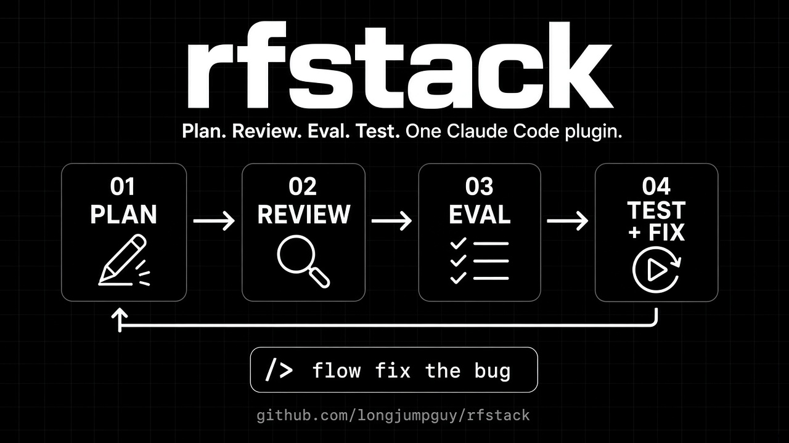

# rfstack



A Claude Code plugin for a short coding workflow. Version 0.2 adds three lean commands on top of the original four steps.

The original `/flow` path:

1. **Plan** (`/flow-plan`) – research first, then grill you into a one-page PRD before any code.
2. **Review** (`/flow-review`) – adversarial review to simplify and de-bloat. Max 2 rounds.
3. **Eval** (`/flow-eval`) – a fresh-context `flow-evaluator` scores the diff against a rubric.
4. **Test + repair** (`/flow-test`) – run the app, fail, fix, retest (max 3 loops), then hand to a human.

`/flow <task>` runs all four. Artifacts go in `.flow/` in the project.

v0.2 commands, lean unless you pass `--deep`:

- `/rf-new` – start work on a branch named `rf/<slug>`.
- `/rf-audit` – read-only quality check. `--diff <base>` looks only at what the branch changed.
- `/rf-scan` – scanners first (gitleaks, osv-scanner, semgrep, Supabase advisors), then a short AI review. `--partial` continues when a scanner is not installed.
- `/rf-design` – read-only design check for any website or app, in any language and on any screen size. It checks spacing, proportions, alignment, zoom, narrow screens, contrast and motion, and never changes colours, fonts or brand.
  Layer 1 is universal and always runs. Layer 2 checks the project's own `DESIGN.md` (Clueless repos use `skills/rf-design/clueless-rules.md`). `--all` writes a whole-app baseline; `--release` checks three browsers.

Recipes name skills in full (`pstack:tdd`, `ponytail:ponytail-audit`). They do not copy those skills into this repo.

## Guardrails
- Work on a branch. Never merge, push to `main`, tag, or release without an explicit yes in chat.
- Ponytail level **full** is on for every `/rf-*` and `/flow*` command, including helper agents. You can turn ponytail off. The next rfstack command turns full back on.
- Any step that edits the repo is marked **change, branch-only, ask first**.
- No secrets in code, commits, or logs.
- Each run shows its spending cap up front and the cost at the end.

## Rubric
Default in `rubric.md`. A project can override it with `.claude/rubric.md`.

`/flow-eval` looks for the rubric in this order, and does not fail when `CLAUDE_PLUGIN_ROOT` is unset:

1. `.claude/rubric.md` in the project
2. `${CLAUDE_PLUGIN_ROOT}/rubric.md` when that variable is set
3. `~/.cursor/plugins/local/rfstack/rubric.md`
4. The default rubric written inside `commands/flow-eval.md`

## Install

Repo: [ACMAGI7/rfstack](https://github.com/ACMAGI7/rfstack).

```bash
claude plugin marketplace add ACMAGI7/rfstack
claude plugin install rfstack@rfstack
```

Install the plugins and skills the recipes point at. rfstack does not vendor them.

```bash
claude plugin marketplace add DietrichGebert/ponytail
claude plugin install ponytail@ponytail

claude plugin marketplace add michael-denyer/pstack-claude
claude plugin install pstack@pstack-claude

npx skills add garrytan/gstack
npx skills add mattpocock/skills
npx skills add obra/superpowers
npx skills add kunchenguid/no-mistakes
```

Scanners used by `/rf-scan` (the scan still runs with `--partial` if some are missing):

```bash
brew install gitleaks osv-scanner semgrep
```

Turn gstack telemetry off, and turn `codex_reviews` off for client and ACMAG work. `scripts/preflight.sh` checks both and does not change them:

```bash
~/.claude/skills/gstack/bin/gstack-config get telemetry   # must print off
```

Ponytail level full is the default. To pin it: `PONYTAIL_DEFAULT_MODE=full`, or `~/.config/ponytail/config.json` with `{"defaultMode":"full"}`.

### Untested extra

`plugin.json` lists `dependencies` on `ponytail` (marketplace `ponytail`, `>=5.3.0`) and `pstack` (marketplace `pstack-claude`, `>=0.9.90`). `marketplace.json` sets `allowCrossMarketplaceDependenciesOn` to `ponytail` and `pstack-claude`.

That cross-marketplace install was **not tested**. This environment has no `claude` binary, so nobody has run `claude plugin install` here. Until that test passes, the ponytail line inside each command is the guarantee. The dependency fields and `hooks/ponytail-guard.sh` are backups. Install ponytail and pstack yourself with the commands above.

Use [michael-denyer/pstack-claude](https://github.com/michael-denyer/pstack-claude). The old `q-qp-p/pstack` pointer is dropped.

## Skills in this plugin
Short skills under `skills/`. Each one starts with the same pre-flight and the ponytail line.

- `rf-release` – certificates, build number, signing, build, Apple's pre-upload check, then a hard stop before any upload or notarization submit.
- `rf-auth-check` – sign-in from start to finish on each platform. Test accounts only.
- `rf-stripe` – checkout, webhooks, refunds, renewals. Test mode only. Refuses any key that starts with `sk_live`.
- `rf-tax-tests` – known-answer tax tests, rounding, Buddhist-calendar dates. Not legal advice.
- `rf-privacy` – where personal data goes, logs, retention, privacy label. Not legal advice.

Not in this version: `rf-migrate`, and promptfoo evals. Those come later.

`bot-skills/` holds drafts of the same three recipes plus `rf-shared`, for a cloud agent that does not load the plugin. They are generated from `commands/`. Edit the command file, then update the bot skill to match.

## Pointed at, not copied
Trail of Bits skills ([trailofbits/skills](https://github.com/trailofbits/skills)) are **CC-BY-SA-4.0**. `/rf-scan --deep` and `rf-tax-tests` name them (`rust-review`, `insecure-defaults`, `supply-chain-risk-auditor`, `fp-check`, `variant-analysis`, `property-based-testing`, `mutation-testing`). Install that plugin on its own. Do not copy those files into this MIT repo.

```bash
npx skills add trailofbits/skills
```

Supabase advisors are used through `get_advisors` only. Do not copy supabase/splinter (no licence file).

## Credits
Recipes point at these projects. Their text stays in their repos. Notices below are for attribution.

- [DietrichGebert/ponytail](https://github.com/DietrichGebert/ponytail) – MIT © Dietrich Gebert
- [michael-denyer/pstack-claude](https://github.com/michael-denyer/pstack-claude) – MIT © Lauren Tan, plus thermos and cursor-team-kit MIT notices in that repo
- [garrytan/gstack](https://github.com/garrytan/gstack) – MIT © Garry Tan. Some files are based on Apache-2.0 code; see that repo's NOTICE.md. We do not copy those files. Telemetry stays off.
- [mattpocock/skills](https://github.com/mattpocock/skills) – MIT © Matt Pocock
- [obra/superpowers](https://github.com/obra/superpowers) – MIT. Already used by `/flow` (`writing-plans`, `systematic-debugging`, `verification-before-completion`, and others).
- [kunchenguid/no-mistakes](https://github.com/kunchenguid/no-mistakes) – MIT. Pre-push check used by `/flow-review`.
- poteto/how and the Cursor thermos plugin – MIT © Lauren Tan and MIT © Cursor. Use the copies inside pstack. Do not add a second copy.
- [trailofbits/skills](https://github.com/trailofbits/skills) – CC-BY-SA-4.0. Point only. Do not copy.
- Strix (`penetration-testing-with-strix`) – Apache-2.0. Off unless Chase names a test URL for that run.
- stripe/ai `stripe-best-practices` – MIT. Used by `rf-stripe`. Test mode only.
- [vercel-labs/agent-skills](https://github.com/vercel-labs/skills) – no licence file found. Use only, do not copy. Not required for v0.2.

`q-qp-p/pstack` is not used.

## License
MIT. See [LICENSE](LICENSE).
