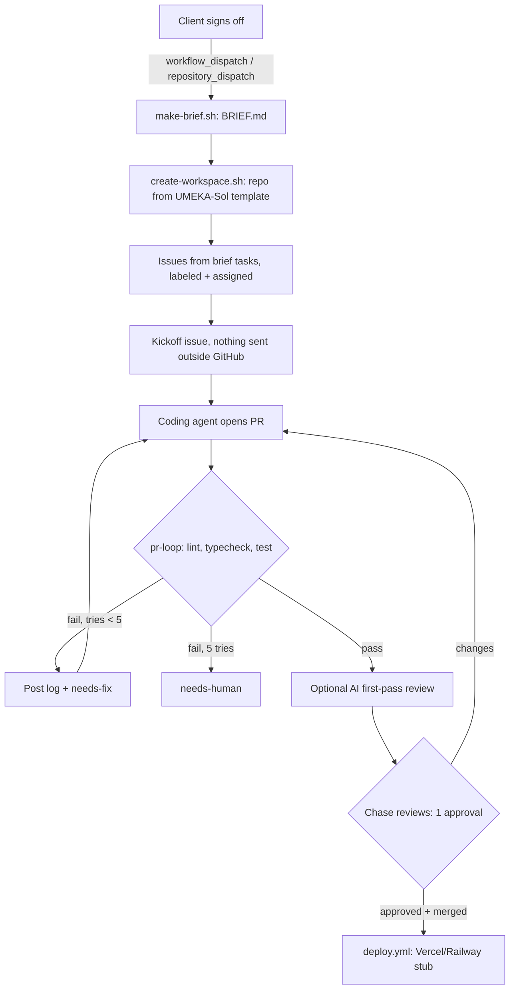

# Refinery Solutions delivery pipeline

Reusable kit for client projects (example template: `ACMAGI7/UMEKA-Sol`). Not for Clueless.

## Build order
1. **Client intake** (built first): sign-off trigger → brief → workspace → tasks → kickoff.
2. **PR self-test loop**: every PR runs install, lint, typecheck, tests; failures go back to the agent, max 5 tries.
3. **Single human gate**: main needs green checks + 1 approval, then deploy on merge.

## Files
| File | Does |
|---|---|
| `.github/workflows/client-signoff.yml` | Trigger. Inputs: client, scope, who/what/obstacle/cost, dry_run |
| `pipeline/scripts/make-brief.sh` | Fills `templates/brief.md` + `templates/kickoff.md` into `out/` |
| `pipeline/scripts/create-workspace.sh` | Repo from template, BRIEF.md, labels, issues, kickoff issue. `DRY_RUN=1` default |
| `pipeline/templates/workflows/pr-loop.yml` | Copy into client repo. Self-test loop |
| `pipeline/templates/workflows/deploy.yml` | Copy into client repo. Deploy on merge (stub) |
| `pipeline/scripts/protect-main.sh` | Applies the human gate to a repo |

Try locally: `CLIENT="Acme" SCOPE="Stock app" pipeline/scripts/make-brief.sh && CLIENT=Acme pipeline/scripts/create-workspace.sh`

## Manual setup checklist
- [ ] Tick "Template repository" on `ACMAGI7/UMEKA-Sol` (or pick another template).
- [ ] Add secret `PIPELINE_GH_TOKEN` in rfstack (fine-grained token: create repos, issues, contents on ACMAGI7).
- [ ] First run with `dry_run=1`, then `0`.
- [ ] Copy `pr-loop.yml` and `deploy.yml` into each client repo's `.github/workflows/`.
- [ ] Run `pipeline/scripts/protect-main.sh ACMAGI7/<client>-sol` (needs repo admin).
- [ ] Optional: secret `AI_REVIEW_KEY` and fill in the review step.
- [ ] Deploy target: secret `VERCEL_TOKEN` or `RAILWAY_TOKEN`, edit `deploy.yml`, create `production` environment.
- [ ] Notion: secret `NOTION_TOKEN` + database id, then fill the TODO in `create-workspace.sh`.
- [ ] Drive: secret `GDRIVE_SA_JSON` + parent folder id, then fill the TODO.
